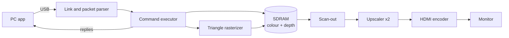

# DTGC: a small GPU on an FPGA, driven over USB

DTGC is a graphics chip I am building on the Sipeed Tang Nano 20K FPGA board. A PC sends drawing commands over USB, the FPGA draws into memory, and the picture goes out over HDMI to a monitor.

**Status: nothing has run on real hardware yet.** Every result here comes from simulation (running the Verilog on a PC) or from the emulator (a Python copy of the GPU). "Passes simulation" never means "works on the board". Real results go in [docs/test-log.md](docs/test-log.md).

## The plan

1. **Basics.** Install free open-source FPGA tools, read the board's schematic, blink an LED, show colour bars over HDMI, and keep a picture in the board's SDRAM memory.
2. **Talk to a PC.** A USB protocol with checksums and retries, a parser on the FPGA, and a Python emulator of the GPU so software can be tested without a board.
3. **Draw in 3D.** A triangle rasterizer with depth test, colour blending and textures, then a spinning cube demo.
4. **Make it fast.** Measure a frame in simulation and remove the slowest parts one at a time.
5. **HD output.** 720p and 1080p, with an upscaler so 1080p fits the board's memory and speed. Target: 1080p at 30 fps.
6. **Make it useful.** An app window, small games, a graphics API, and a small Direct3D 9 bridge for old programs.
7. **Faster USB.** Windows and Linux app packages, and a link through an FT2232H USB 2.0 chip, much faster than the board's own serial port.
8. **A board for the fast link.** A small 4-layer "backpack" PCB with the FT2232H that plugs on top of the Tang Nano 20K.
9. **Ready to order.** A 3D-printed case, the files an assembly service needs, and a line-by-line check of the schematic against the chip's datasheet.
10. **Wrap up.** How to run and test everything, then real hardware tests.

Rules for the whole project: free tools only, every Verilog module gets a testbench, and no pin or voltage is guessed. Anything not yet confirmed is marked VERIFY.

## Progress log

Each update below was added when that step was finished. Older updates stay as they were written.

<!-- part 1 -->
### Update 1: Tools, first blink, colour bars and memory

The starting point: free tools, a check that they support this board, and the first three pieces of hardware design.

- **Tools.** Only free open-source tools: Yosys, nextpnr-himbaechel with Apicula, openFPGALoader and Icarus Verilog, all from the OSS CAD Suite. No vendor tools. Install steps are in [docs/setup.md](docs/setup.md), installed versions in [tools/versions.md](tools/versions.md), and what to buy in [docs/shopping-list.md](docs/shopping-list.md).
- **Board research.** Pins come from Sipeed's schematic, not from guesses. Any pin, voltage or timing not yet confirmed is marked VERIFY in [docs/verify.md](docs/verify.md). The pins used are in [docs/board/pins-needed.md](docs/board/pins-needed.md).
- **Blink an LED** (`rtl/blink.v`). The smallest test that the build and flash chain works. Passes simulation and the bitstream builds.
- **640x480 HDMI colour bars** (`rtl/video_timing.v`, `rtl/tmds_encoder.v`, `rtl/hdmi_out.v`). Screen timing plus TMDS, the encoding HDMI uses for each colour wire. Passes simulation and the bitstream builds.
- **SDRAM framebuffer** (`rtl/sdram_ctrl.v`, `rtl/fb_scanout.v`). The picture is kept in the board's SDRAM memory and read out to the screen. A memory model fails the test on any broken timing rule. Writing it found two mistakes: too few memory refreshes in the first plan, and stray pixels after reset.

The overall plan is in [docs/design-plan.md](docs/design-plan.md) and the milestone list in [docs/roadmap.md](docs/roadmap.md).

Next: get commands from a PC into the GPU, and a way to test without a board.

<!-- part 2 -->
### Update 2: USB protocol, emulator and tests

The GPU learns to take commands from a PC, and everything gets a test.

- **Protocol** ([docs/protocol.md](docs/protocol.md)). Binary packets with checksums, sequence numbers and retries. On the FPGA, `rtl/uart_rx.v` receives, `rtl/pkt_parser.v` checks each packet and `rtl/cmd_exec.v` runs it. The first UART version cut the stop bit short; the tests caught it.
- **Emulator** (`sw/dtgc/emulator.py`). A Python copy of the GPU that speaks the same protocol over TCP. It matches the Verilog bit for bit on random command streams, so software can be written and tested with no board.
- **Library and command line** (`sw/dtgc/`). Finds the board, or falls back on the emulator. Has a self-test, and record and replay.
- **Tests.** `python scripts/run_tests.py --quick` runs everything. [scripts/mutation_check.py](scripts/mutation_check.py) plants one bug at a time in the Verilog and checks that some test fails.
- **Saving link bandwidth.** Only changed tiles are sent, with run-length compression. A benchmark mode measures it: from 9 bytes per frame for a still picture up to 120,522 bytes for noise ([docs/benchmarks.md](docs/benchmarks.md)).

Next: draw triangles.

<!-- part 3 -->
### Update 3: Drawing triangles in 3D

- **Triangle rasterizer** (`rtl/raster.v`, [docs/rasterizer.md](docs/rasterizer.md)). Fixed-point maths for the triangle edges, colour blended across each triangle, a depth test so nearer things hide farther ones, and textures. Bit for bit the same as the Python reference.
- **Dither** ([docs/windows-and-color-options.md](docs/windows-and-color-options.md)). Smoother colour from few bits: 42.1 dB against 21.8 dB without dither.
- **Spinning cube demo.** `python -m sw.dtgc spin`. The picture above is what the Verilog drew in simulation, and it matches the emulator.

Size and speed of every build is recorded in [docs/resources.md](docs/resources.md).

Next: make drawing faster.

<!-- part 4 -->
### Update 4: Making it faster

Five speed steps, each measured in simulation on the same cube frame (340x340 picture):

| Step | Cube frame |
|---|---|
| Starting point (25.2 MHz clock) | about 46 ms |
| Keep SDRAM rows open | about 16 ms |
| One pixel per clock, burst depth reads | about 8 ms |
| Faster clears | about 5 ms |
| Fast depth clear, posted writes, skip empty space | 205,978 clocks down to about 88,000 |

Last, the drawing clock went from about 26 MHz to 46.41 and 48 MHz. That passes the timing estimate and simulation. The SDRAM pin timing is not checked yet (VERIFY).

Next: higher resolutions, up to 1080p.

<!-- part 5 -->
### Update 5: HD output and 1080p30

- **More resolutions.** 1280x720 at 60 Hz and 1920x1080 at 50 Hz. The fast serial clocks these need are untested against the chip's limits (VERIFY).
- **Upscalers** ([docs/upscale.md](docs/upscale.md)). A Python model first (DT-Upscale), then a bilinear upscaler and an edge-directed x2 upscaler in Verilog. Both match the model bit for bit. No neural networks.
- **Indexed triangle lists.** A corner shared by several triangles is sent once. The 1148-triangle field scene needs 3.43 times fewer bytes.
- **1080p at 30 fps** ([docs/architecture-1080p30.md](docs/architecture-1080p30.md)). The GPU draws a 960x540 picture and the edge upscaler doubles it to 1920x1080 on the way out. Drawing every pixel at full size does not fit the board's memory or time ([docs/hd-limits.md](docs/hd-limits.md)).

Two clock domains: drawing at 46.41 MHz, video at 74.25 MHz with a 371.25 MHz serial clock.

| Measured in simulation | Result |
|---|---|
| Spinning cube, 1080p30 build | 255,780 clocks, 5.51 ms |
| Field of 1148 triangles, 1080p30 build | 1,521,436 clocks, 32.8 ms, 30.5 fps (1.6% inside the budget) |
| Largest build, `top_gpu_1080p30` | 12,740 of 20,736 LUTs (61%), 10 of 46 block RAMs, core clock estimate 54.52 MHz (needs 46.41) |

What to check first on a real board: [docs/first-hardware.md](docs/first-hardware.md).

Next: an app and a graphics API so programs can use the GPU.
