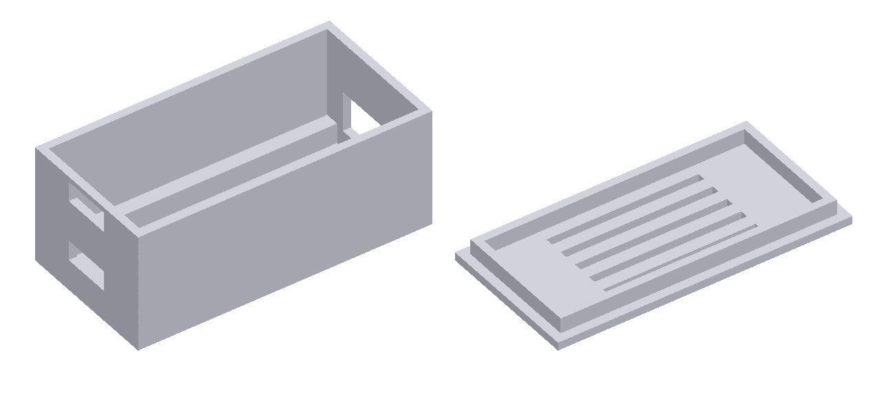

# xDTGC case (Milestone 13)

A two-part 3D-printed case: a tray that holds the Tang Nano 20K with the backpack on top, and a push-on lid with vent slots. The picture is a preview of the files, not a photo of a real print. Nothing has been test-fitted.

**Do not print it yet.** The drawing I have of the Tang gives only its outline (54.04 x 22.55 mm), not its connector positions or part heights. Those numbers are my placeholders, so a print made today would probably not fit.

Files: `pcb/case/xdtgc_case_tray.stl` and `pcb/case/xdtgc_case_lid.stl`. Both are closed surfaces, which a slicer (the program that prepares a 3D print) needs. Print the lid with its flat top on the bed.

## Before printing

When both boards are here:

1. With calipers, measure each number marked VERIFY at the top of `scripts/case_stl.py`.
2. Tell me the numbers, or edit them in the script yourself.
3. Run `python scripts/case_stl.py` to remake the files.

Holes:

| Hole | Wall | For |
|---|---|---|
| Upper | USB end | Backpack USB-C, the one normal use needs |
| Lower | USB end | The Tang's own USB port, for flashing |
| Large | Far end | HDMI. Which end the Tang's HDMI is really on is VERIFY |

The lid is held by friction only, using a 0.2 mm gap around its lip. That gap may need changing for your printer (`FIT` in the script).
