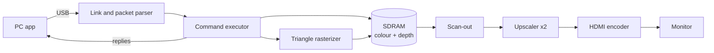
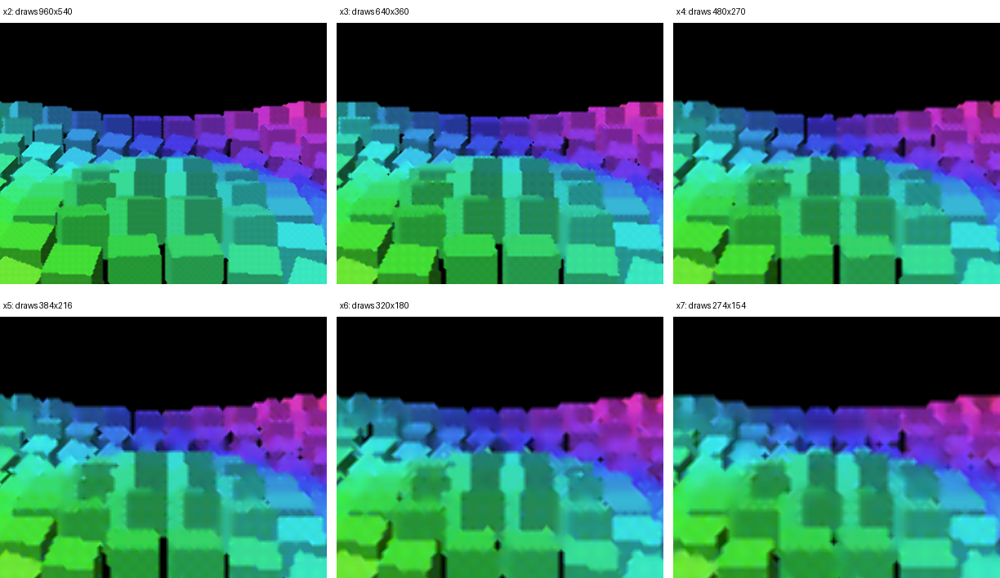
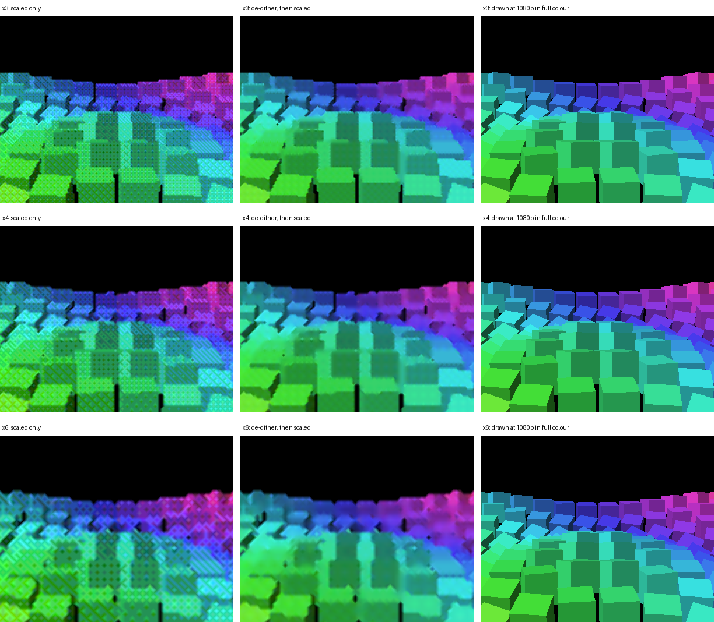

# DTGC: a small GPU on an FPGA, driven over USB

DTGC is a graphics chip I am building on the Sipeed Tang Nano 20K FPGA board. A PC sends drawing commands over USB, the FPGA draws into memory, and the picture goes out over HDMI to a monitor.

**Status: nothing has run on real hardware yet.** Every result here comes from simulation (running the Verilog on a PC) or from the emulator (a Python copy of the GPU). "Passes simulation" never means "works on the board". Real results go in [docs/test-log.md](docs/test-log.md).

## The plan

1. **Basics.** Install free open-source FPGA tools, read the board's schematic, blink an LED, show colour bars over HDMI, and keep a picture in the board's SDRAM memory.
2. **Talk to a PC.** A USB protocol with checksums and retries, a parser on the FPGA, and a Python emulator of the GPU so software can be tested without a board.
3. **Draw in 3D.** A triangle rasterizer with depth test, colour blending and textures, then a spinning cube demo.
4. **Make it fast.** Measure a frame in simulation and remove the slowest parts one at a time.
5. **HD output.** 720p and 1080p, with an upscaler so 1080p fits the board's memory and speed. Target: 1080p at 30 fps.
6. **Make it useful.** An app window, small games, a graphics API, and a small Direct3D 9 bridge for old programs.
7. **Faster USB.** Windows and Linux app packages, and a link through an FT2232H USB 2.0 chip, much faster than the board's own serial port.
8. **A board for the fast link.** A small 4-layer "backpack" PCB with the FT2232H that plugs on top of the Tang Nano 20K.
9. **Ready to order.** A 3D-printed case, the files an assembly service needs, and a line-by-line check of the schematic against the chip's datasheet.
10. **Wrap up.** How to run and test everything, then real hardware tests.

Rules for the whole project: free tools only, every Verilog module gets a testbench, and no pin or voltage is guessed. Anything not yet confirmed is marked VERIFY.

## Progress log

Each update below was added when that step was finished. Older updates stay as they were written.

<!-- part 1 -->
### Update 1: Tools, first blink, colour bars and memory

The starting point: free tools, a check that they support this board, and the first three pieces of hardware design.

- **Tools.** Only free open-source tools: Yosys, nextpnr-himbaechel with Apicula, openFPGALoader and Icarus Verilog, all from the OSS CAD Suite. No vendor tools. Install steps are in [docs/setup.md](docs/setup.md), installed versions in [tools/versions.md](tools/versions.md), and what to buy in [docs/shopping-list.md](docs/shopping-list.md).
- **Board research.** Pins come from Sipeed's schematic, not from guesses. Any pin, voltage or timing not yet confirmed is marked VERIFY in [docs/verify.md](docs/verify.md). The pins used are in [docs/board/pins-needed.md](docs/board/pins-needed.md).
- **Blink an LED** (`rtl/blink.v`). The smallest test that the build and flash chain works. Passes simulation and the bitstream builds.
- **640x480 HDMI colour bars** (`rtl/video_timing.v`, `rtl/tmds_encoder.v`, `rtl/hdmi_out.v`). Screen timing plus TMDS, the encoding HDMI uses for each colour wire. Passes simulation and the bitstream builds.
- **SDRAM framebuffer** (`rtl/sdram_ctrl.v`, `rtl/fb_scanout.v`). The picture is kept in the board's SDRAM memory and read out to the screen. A memory model fails the test on any broken timing rule. Writing it found two mistakes: too few memory refreshes in the first plan, and stray pixels after reset.

The overall plan is in [docs/design-plan.md](docs/design-plan.md) and the milestone list in [docs/roadmap.md](docs/roadmap.md).

Next: get commands from a PC into the GPU, and a way to test without a board.

<!-- part 2 -->
### Update 2: USB protocol, emulator and tests

The GPU learns to take commands from a PC, and everything gets a test.

- **Protocol** ([docs/protocol.md](docs/protocol.md)). Binary packets with checksums, sequence numbers and retries. On the FPGA, `rtl/uart_rx.v` receives, `rtl/pkt_parser.v` checks each packet and `rtl/cmd_exec.v` runs it. The first UART version cut the stop bit short; the tests caught it.
- **Emulator** (`sw/dtgc/emulator.py`). A Python copy of the GPU that speaks the same protocol over TCP. It matches the Verilog bit for bit on random command streams, so software can be written and tested with no board.
- **Library and command line** (`sw/dtgc/`). Finds the board, or falls back on the emulator. Has a self-test, and record and replay.
- **Tests.** `python scripts/run_tests.py --quick` runs everything. [scripts/mutation_check.py](scripts/mutation_check.py) plants one bug at a time in the Verilog and checks that some test fails.
- **Saving link bandwidth.** Only changed tiles are sent, with run-length compression. A benchmark mode measures it: from 9 bytes per frame for a still picture up to 120,522 bytes for noise ([docs/benchmarks.md](docs/benchmarks.md)).

Next: draw triangles.

<!-- part 3 -->
### Update 3: Drawing triangles in 3D


- **Triangle rasterizer** (`rtl/raster.v`, [docs/rasterizer.md](docs/rasterizer.md)). Fixed-point maths for the triangle edges, colour blended across each triangle, a depth test so nearer things hide farther ones, and textures. Bit for bit the same as the Python reference.
- **Dither** ([docs/windows-and-color-options.md](docs/windows-and-color-options.md)). Smoother colour from few bits: 42.1 dB against 21.8 dB without dither.
- **Spinning cube demo.** `python -m sw.dtgc spin`. The picture above is what the Verilog drew in simulation, and it matches the emulator.

Size and speed of every build is recorded in [docs/resources.md](docs/resources.md).

Next: make drawing faster.

<!-- part 4 -->
### Update 4: Making it faster

Five speed steps, each measured in simulation on the same cube frame (340x340 picture):

| Step | Cube frame |
|---|---|
| Starting point (25.2 MHz clock) | about 46 ms |
| Keep SDRAM rows open | about 16 ms |
| One pixel per clock, burst depth reads | about 8 ms |
| Faster clears | about 5 ms |
| Fast depth clear, posted writes, skip empty space | 205,978 clocks down to about 88,000 |

Last, the drawing clock went from about 26 MHz to 46.41 and 48 MHz. That passes the timing estimate and simulation. The SDRAM pin timing is not checked yet (VERIFY).

Next: higher resolutions, up to 1080p.

<!-- part 5 -->
### Update 5: HD output and 1080p30

- **More resolutions.** 1280x720 at 60 Hz and 1920x1080 at 50 Hz. The fast serial clocks these need are untested against the chip's limits (VERIFY).
- **Upscalers** ([docs/upscale.md](docs/upscale.md)). A Python model first (DT-Upscale), then a bilinear upscaler and an edge-directed x2 upscaler in Verilog. Both match the model bit for bit. No neural networks.
- **Indexed triangle lists.** A corner shared by several triangles is sent once. The 1148-triangle field scene needs 3.43 times fewer bytes.
- **1080p at 30 fps** ([docs/architecture-1080p30.md](docs/architecture-1080p30.md)). The GPU draws a 960x540 picture and the edge upscaler doubles it to 1920x1080 on the way out. Drawing every pixel at full size does not fit the board's memory or time ([docs/hd-limits.md](docs/hd-limits.md)).



Two clock domains: drawing at 46.41 MHz, video at 74.25 MHz with a 371.25 MHz serial clock.

| Measured in simulation | Result |
|---|---|
| Spinning cube, 1080p30 build | 255,780 clocks, 5.51 ms |
| Field of 1148 triangles, 1080p30 build | 1,521,436 clocks, 32.8 ms, 30.5 fps (1.6% inside the budget) |
| Largest build, `top_gpu_1080p30` | 12,740 of 20,736 LUTs (61%), 10 of 46 block RAMs, core clock estimate 54.52 MHz (needs 46.41) |

What to check first on a real board: [docs/first-hardware.md](docs/first-hardware.md).

Next: an app and a graphics API so programs can use the GPU.

<!-- part 6 -->
### Update 6: Apps, games and the graphics API

- **Shader** (`rtl/shade_pipe.v`). A pipelined fixed-point shader that matches its model bit for bit. Built and tested, not yet connected to the GPU.
- **App and games.** `python -m sw.dtgc app` opens one window for everything. `python -m sw.dtgc play pong` runs a game. Tested on the emulator only.
- **Graphics API** ([docs/api.md](docs/api.md)). Canvas, meshes and frames for your own programs.
- **Three versions** ([docs/versions.md](docs/versions.md)). One app runs all three:

| | This PC only | Board, HDMI out | Board, USB out |
|---|---|---|---|
| What you need | Nothing extra | Tang Nano 20K, HDMI cable, monitor | Tang Nano 20K |
| Who draws | The PC's own graphics card | The FPGA | The FPGA |
| Where the picture goes | A window | A monitor | A window on the PC |

- **Direct3D 9 subset** ([docs/direct3d.md](docs/direct3d.md)). A small `d3d9.dll` so some old fixed-function Direct3D 9 programs can draw on DTGC. Modern games will not run.

Next: app packages and a faster USB link.

<!-- part 7 -->
### Update 7: Windows packages and the fast USB link

- **Windows device** ([docs/windows-device.md](docs/windows-device.md)). A software device so DTGC shows in Device Manager. Untested, because it needs admin rights.
- **App packages** ([docs/driver-app.md](docs/driver-app.md)). `scripts/package_windows.py` builds a portable `dtgc.exe` (its self-test passes). `scripts/package_linux.py` builds a Linux package, which has not been run on Linux.
- **FT2232H link** (`rtl/ft_link.v`, `rtl/top_gpu_ft.v`). The board's own USB serial port is assumed at about 0.3 MB/s (not yet measured), which gives about 19.5 fps for the field scene. The FT2232H chip moves 8 bits at a time at 60 MHz, up to about 40 MB/s by its datasheet. The whole GPU with this link passes simulation. It must pass the breakout test in [docs/ft2232h-test.md](docs/ft2232h-test.md) before any board is ordered.

Next: a small board that carries the fast USB chip.

<!-- part 8 -->
### Update 8: The xDTGC backpack board


A small 4-layer board that plugs on top of the Tang Nano 20K and carries the FT2232H. One USB-C cable powers both boards and carries the data. It does not add drawing power or change the HDMI resolution; it only makes the link faster.

| Item | Value |
|---|---|
| Size | 54.04 x 25 mm, the same length as the Tang Nano 20K |
| Layers | 4: top signals, ground, 3.3 V, bottom signals |
| Main chips | FT2232HL (USB to FIFO), 93LC56B (settings memory), AP2114H-3.3 (3.3 V regulator) |
| Protection | 500 mA resettable fuse, USB ESD diode, Schottky diode so two USB cables cannot fight |
| Fitting | Two 1x20 sockets underneath plug onto the Tang's pins |
| Files | `pcb/backpack/tinygpu_backpack.kicad_sch` (schematic) and `pcb/backpack/tinygpu_backpack.kicad_pcb` (layout), KiCad 10 |

The layout is made by scripts, so it can be rebuilt the same way every time: `scripts/pcb_place.py` places the parts and `scripts/pcb_route.py` routes them. The schematic rule check gives 0 errors and the layout rule check 0 errors, 0 unconnected. The layout review list is [docs/pcb-layout-review.md](docs/pcb-layout-review.md), and how assembly services work is in [docs/pcb-assembly.md](docs/pcb-assembly.md).

Next: a case, the order files, and a careful check of the schematic.

<!-- part 9 -->
### Update 9: Case, order files and datasheet review


- **Case** (`pcb/case/`, [docs/case.md](docs/case.md)). A 3D-printable tray and lid. Its sizes are placeholders until the real boards are measured, so do not print it yet.
- **Order files** (`pcb/backpack/quote/`). Gerbers, BOM and part positions, made by `python scripts/pcb_quote_pack.py`, which stops if the rule check finds any error. 39 parts on 20 BOM lines, about USD 12.86 per board at cached prices. Not a quote, and stock is not checked. Quote notes: [docs/pcbway-quote.md](docs/pcbway-quote.md).
- **Datasheet review.** The schematic was checked line by line against the FT2232H datasheet (version 2.3). That fixed four mistakes the automatic checks passed: two filter capacitors on the wrong side of their beads, the settings-memory pull-up on the wrong side of its resistor, the reset pin tied straight to 3.3 V, and a regulator that needed capacitors this board does not use. The board was then re-routed with no vias inside pads: 122 vias, 0.20 mm drill. The USB pair is 0.25 mm tracks with a 0.25 mm gap, about 93 ohm by hand formula (target 90). Lessons from all this: [docs/lessons.md](docs/lessons.md).

Before ordering:

1. Test the FT2232H on a breakout module with jumper wires ([docs/ft2232h-test.md](docs/ft2232h-test.md)). Expected: data passes both ways with no errors. If it fails, do not order.
2. Measure the real Tang Nano 20K. Expected: 20.32 mm between the two pin rows, and the tallest part lower than the 8.5 mm sockets.
3. Review the layout with [docs/pcb-layout-review.md](docs/pcb-layout-review.md).
4. Get a quote. Expected: the fab accepts the 0.20 mm vias and gives a USB pair impedance near 90 ohm.
5. Check stock of all 20 BOM lines on order day.

After the boards arrive, test them with [docs/pcb-home-test.md](docs/pcb-home-test.md).

Next: write up how to run everything.

<!-- part 10 -->
### Update 10: Running it, and what is left

Try it on a PC with no board. Needs Python 3 and `pip install pyserial numpy pillow`.

```bash
python -m sw.dtgc emulator --window
```

Then, in a second terminal:

```bash
python -m sw.dtgc spin --scene field
```

Tests and builds. Simulation needs Icarus Verilog; builds need the OSS CAD Suite.

```bash
python scripts/run_tests.py --quick
```

```bash
python scripts/build_all.py
```

Every push to GitHub runs the quick tests ([.github/workflows/tests.yml](.github/workflows/tests.yml)). The last full mutation run caught 180 of 180 planted bugs at 340x340 and 8 of 8 specific to the 960x540 picture.

| Folder | Contents |
|---|---|
| `rtl/` | Verilog for the GPU |
| `sim/` | Testbenches, memory and FT2232H models |
| `constraints/` | Pin and clock files for the Tang Nano 20K |
| `sw/` | PC software and tests |
| `scripts/` | Build, test, measure, package, PCB and case scripts |
| `pcb/` | Backpack board, order files and case |
| `docs/` | Design notes, limits, benchmarks, open questions and lessons |

What it is not:

- Not a replacement for a PC graphics card. A modern PC draws far faster; this is for learning, HDMI output and taking simple drawing off the PC.
- No DirectX 10 to 12, Vulkan or programmable shaders, and no Windows kernel display driver.
- 1080p30 is a 960x540 picture doubled by the upscaler.

Still open: everything on real hardware. The steps are in [docs/roadmap.md](docs/roadmap.md), unconfirmed values in [docs/verify.md](docs/verify.md). The Tang Nano 20K schematics are Sipeed's and are not included; get them from Sipeed's wiki.

Next: build the hardware and test each step on the real board, starting with the LED blink.

<!-- part 11 -->
### Update 11: Super upscale, 3x to 7x

People asked for more upscaling, so the edge upscaler now takes any whole scale from 2 to 12. The 1080p30 output can now come from five smaller pictures as well as the 960x540 one. A smaller picture draws faster, but the upscaler cannot add detail that was never drawn, so it looks softer.



| Build | Picture | Field scene, 1148 triangles | Spare time per 30 Hz frame | LUTs |
|---|---|---|---|---|
| `gpu_1080p30` | 960x540 (2x) | 32.8 ms | 1.6% | 12,487 |
| `gpu_1080p30x3` | 640x360 (3x) | 19.3 ms | 42% | 12,381 |
| `gpu_1080p30x4` | 480x270 (4x) | 14.0 ms | 58% | 12,407 |
| `gpu_1080p30x5` | 384x216 (5x) | 11.3 ms | 66% | 12,517 |
| `gpu_1080p30x6` | 320x180 (6x) | 9.6 ms | 71% | 12,422 |
| `gpu_1080p30x7` | 274x154 (7x) | 8.7 ms | 74% | 12,490 |

Frame times are from Verilog simulation; build sizes are nextpnr's. Every build passes timing. The screen still refreshes 30 times a second, so the spare time is room for more triangles or a slower link, not a higher frame rate. Each triangle has a fixed setup cost, so the gain shrinks past 4x. 7x leaves a 1-pixel black border, since 274 x 7 is 1918.

How it was tested: 200,000 random pixels per scale against the formula, every screen pixel of two full 1080p frames per scale against the Python scaler, and 12 deliberately planted bugs in the upscaler, all caught. Details are in [docs/upscale.md](docs/upscale.md) and [docs/architecture-1080p30.md](docs/architecture-1080p30.md). None of it has run on a real monitor.

Next: build the hardware. Once the 2x build shows a picture, try 4x and 7x on the same monitor.

<!-- part 12 -->
### Update 12: De-dither, faster drawing and bigger scenes

**De-dither.** The GPU stores 8-bit colour, so a colour it cannot store is drawn as a fine pattern of two that it can (dither). Scaled up 3 to 7 times, each dot of that pattern becomes a visible block. A new filter, `rtl/dedither.v`, averages the pattern away on the small picture just before it is scaled, and leaves real edges where they are.



Scores for the field scene against the same triangles drawn straight at 1080p in full colour. Higher is better:

| Scale | Picture | Before: PSNR (dB) | SSIM | With de-dither: PSNR (dB) | SSIM |
|---|---|---|---|---|---|
| 2x | 960x540 | 27.22 | 0.8283 | 33.01 | 0.9668 |
| 3x | 640x360 | 26.96 | 0.8248 | 31.65 | 0.9596 |
| 4x | 480x270 | 26.76 | 0.8237 | 30.34 | 0.9441 |
| 5x | 384x216 | 26.34 | 0.8251 | 29.39 | 0.9411 |
| 6x | 320x180 | 25.98 | 0.8322 | 28.52 | 0.9325 |
| 7x | 274x154 | 25.69 | 0.8275 | 28.00 | 0.9248 |

With de-dither, 7x scores higher than 2x did without it. This is one flat-shaded scene; a picture with fine real detail one colour step apart would lose that detail, and no such picture has been measured. The builds with the filter end in `dd` (`gpu_1080p30dd`, `gpu_1080p30x3dd` to `gpu_1080p30x7dd`), and the older builds are kept so the two can be compared on a monitor.

**A bug found on the way.** Testing the filter with noise down the sides of the picture showed that the last 4 screen columns of every full-width 1080p30 mode had been blended with the next row's weight. The older test pictures were flat in those columns, where the fault changes nothing. It is fixed in `rtl/fb_scanout_hd.v`, and the tests now paint noise along all four sides.

**Faster drawing.** Three changes to `rtl/raster.v`, none of which changes a pixel: two dividers work side by side, the pixel loop leaves a row at the triangle's last pixel, and no clock is wasted between depth tiles.

| Build | Picture | Field scene before | After | Spare time per 30 Hz frame | LUTs | LUTs with de-dither |
|---|---|---|---|---|---|---|
| `gpu_1080p30` | 960x540 (2x) | 32.8 ms | 29.4 ms | 11.9% | 13,205 | 16,401 |
| `gpu_1080p30x3` | 640x360 (3x) | 19.3 ms | 17.2 ms | 48.5% | 12,936 | 17,148 |
| `gpu_1080p30x4` | 480x270 (4x) | 14.0 ms | 12.4 ms | 62.8% | 13,492 | 16,232 |
| `gpu_1080p30x5` | 384x216 (5x) | 11.3 ms | 9.9 ms | 70.2% | 12,768 | 16,333 |
| `gpu_1080p30x6` | 320x180 (6x) | 9.6 ms | 8.5 ms | 74.6% | 13,633 | 16,412 |
| `gpu_1080p30x7` | 274x154 (7x) | 8.7 ms | 7.6 ms | 77.3% | 13,096 | 16,387 |

The chip has 20,736 LUTs, and every build passes timing. Frame times are from Verilog simulation.

**Bigger scenes.** With the spare time, the largest field scene that still fits a 30 Hz frame is about 1,300 triangles at 2x, 2,800 at 3x and 4,600 at 4x. That is GPU time only; sending that many triangles takes link time too.

**A test for wasted time.** A planted bug that made the rasterizer read memory it did not need drew the same picture, so no comparison test could see it. `sw/tests/test_raster_speed.py` now counts the clocks a cube takes and fails if they go over a budget. With it, the planted-bug check run on 2026-11-12 caught 203 of 203, and 8 of 8 that only a 960x540 picture can show.

Details are in [docs/upscale.md](docs/upscale.md) and [docs/benchmarks.md](docs/benchmarks.md). None of it has run on a real board.

Next: a better-looking case.
