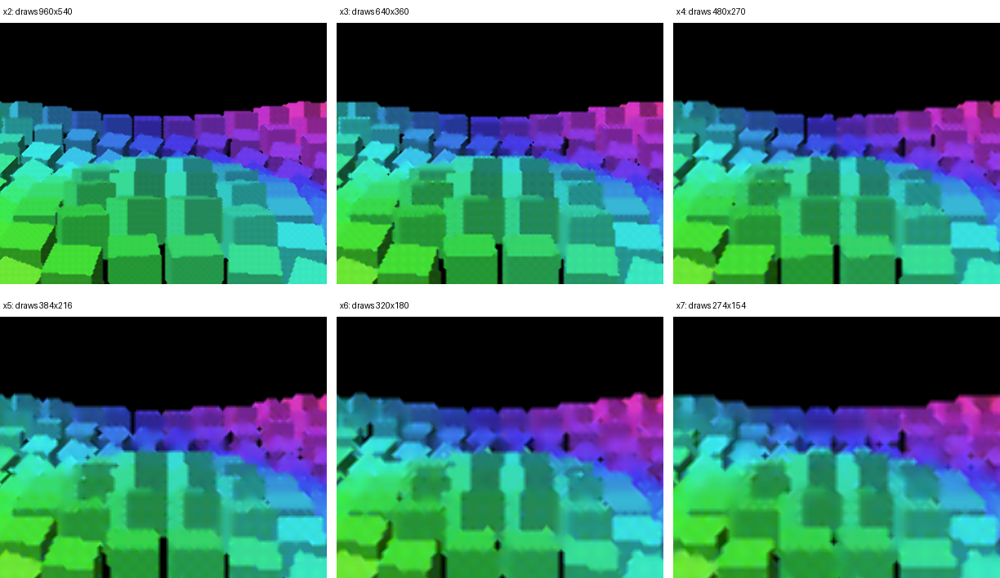
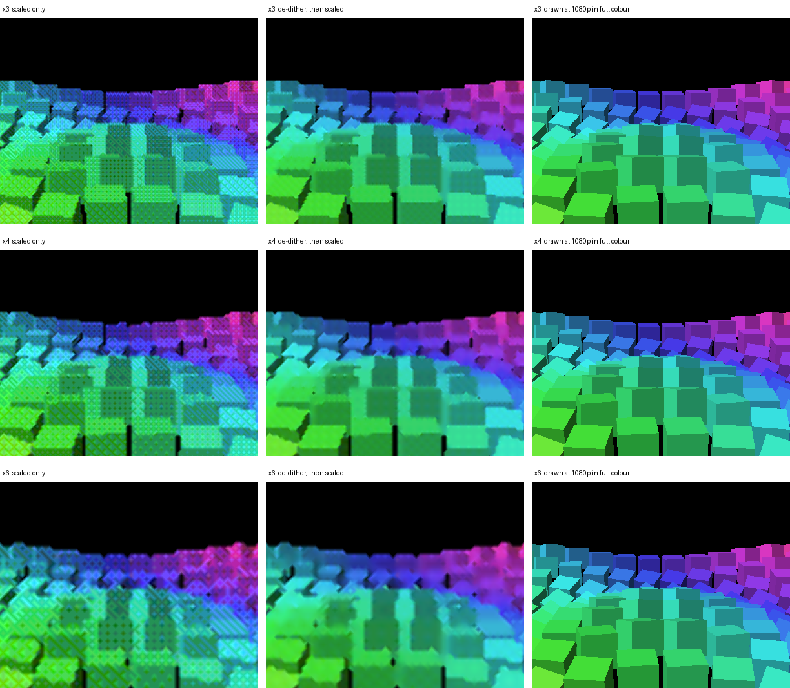

# DT-Upscale

DT-Upscale makes a small drawn picture bigger for the screen, without neural networks.
The Python model is [sw/dtgc/upscale.py](../sw/dtgc/upscale.py). Three methods are also in Verilog and match the model bit for bit in simulation: bilinear ([rtl/upscale_filter.v](../rtl/upscale_filter.v)), edge-directed at any scale from 2 to 12 ([rtl/upscale_edge.v](../rtl/upscale_edge.v)), and edge-directed with de-dither in front ([rtl/dedither.v](../rtl/dedither.v) inside [rtl/fb_scanout_dd.v](../rtl/fb_scanout_dd.v)). Resource numbers are in [resources.md](resources.md). **None of it has been near hardware.**

It uses whole-number scales and integer maths, and each output pixel needs only a small window of input pixels, so it can later become a pipeline of adders and small line memories.

## Methods

| Method | How it works | Pixels read per output pixel |
|---|---|---|
| nearest | Repeats pixels. The baseline | 1 |
| bilinear | Blends the nearest pixels | 4 |
| bicubic | Blends with Catmull-Rom weights, which keeps edges crisper | 16 |
| edge | Splits each square of 4 pixels along the diagonal with the smaller difference, then blends inside the triangle | 4 |
| edge_dd | De-dither first (below), then edge | 16 |

`sharpen` adds back part of the difference between a pixel and its neighbours.

## Scores

Each test shrinks a large picture by averaging, enlarges it again, and compares the result with the original.
PSNR is closeness in decibels, and higher is better. SSIM is a score for how well shapes are kept, where 1 is identical. Regenerate these with `python scripts/upscale_compare.py`, which also writes [images/upscale_compare.png](images/upscale_compare.png).

Fractal picture, scale 2:

| Method | PSNR (dB) | SSIM |
|---|---|---|
| nearest | 28.10 | 0.9720 |
| bilinear | 27.88 | 0.9678 |
| bicubic | 28.23 | 0.9715 |
| bicubic, sharpen 2 | 28.40 | 0.9742 |

Fractal picture, scale 3, PSNR only: nearest 26.85, bilinear 26.93, bicubic 27.10, bicubic with sharpen 2 27.18.

Flat shapes, scale 2: nearest 30.65 dB, SSIM 0.9884. Bilinear 28.02 dB. Bicubic 29.27 dB. Bicubic with sharpen 2 30.81 dB, SSIM 0.9621. Edge 28.36 dB.

Smooth gradient: about 57 dB without sharpening, and about 51 dB with it.

## What these numbers do and do not say

- **Bicubic with a little sharpening is the best all-round choice on these pictures, by a small margin.** The gap from nearest on the fractal is about 0.3 dB.
- **Nearest wins SSIM on flat shapes, and that is partly the test's doing.** Shrinking by averaging leaves flat blocks that repeating pixels restores exactly. A real game frame is drawn at the low size with hard edges, so this test cannot say which looks better there.
- **The edge method did not beat bicubic on any score.** It may still look better on diagonal edges, or it may not. Nobody has judged that by eye on a real screen.
- **Sharpening hurts smooth pictures**, as the gradient shows, so it should be something the program can switch off.
- These scores measure closeness, not how pleasant the picture looks.

## Super upscale: 3x to 7x

[rtl/upscale_edge.v](../rtl/upscale_edge.v) takes any whole scale from 2 to 12. The weights are counted in steps of 1 / (2 x scale),
and the division by 2 x scale is a multiply by a rounded-up reciprocal and a 16-bit shift. That is exact for every sum the blend can make
up to scale 12, checked in Python for each scale. The 1080p30 builds `gpu_1080p30x3` to `gpu_1080p30x7` use it.

Made with `python scripts/compare_upscale.py`, with de-dither (next section) in front of the scaler. Up to 4x the picture stays
fairly clean. At 6x and 7x thin edges go soft and small shapes merge: the upscaler cannot invent detail that was never drawn. Frame times are in
[architecture-1080p30.md](architecture-1080p30.md).

## De-dither: taking the dot pattern back out (2026-11-11)

The GPU stores 8-bit colour, so it draws a colour it cannot store as a fine pattern of two that it can. This is called
dither. At the picture's own size the eye blends the dots. Scaled up 3 to 7 times, each dot becomes a visible block.

De-dither runs on the small picture just before it is scaled. For each pixel it looks at the 8 pixels around it and
takes a weighted average, with weights 1 2 1 / 2 4 2 / 1 2 1. A neighbour only counts if its red, green and blue are
all within one palette step of the pixel's own (37, 37 and 85 out of 255), which is as far apart as two colours of one
dither pattern can be. Any other neighbour is across a real edge, and the pixel's own colour is used in its place.
So the pattern is averaged away and edges between different colours stay where they are. The weights always add up
to 16, which makes the division a shift.

Scores for the field scene against the picture on the right, which is the same triangles drawn straight at 1080p in
full colour. Made with `python scripts/compare_upscale.py`:

| Scale | Picture drawn | edge: PSNR (dB) | SSIM | edge_dd: PSNR (dB) | SSIM |
|---|---|---|---|---|---|
| 2x | 960x540 | 27.22 | 0.8283 | 33.01 | 0.9668 |
| 3x | 640x360 | 26.96 | 0.8248 | 31.65 | 0.9596 |
| 4x | 480x270 | 26.76 | 0.8237 | 30.34 | 0.9441 |
| 5x | 384x216 | 26.34 | 0.8251 | 29.39 | 0.9411 |
| 6x | 320x180 | 25.98 | 0.8322 | 28.52 | 0.9325 |
| 7x | 274x154 | 25.69 | 0.8275 | 28.00 | 0.9248 |

What this does and does not say:

- De-dither at 7x scores higher than the old scaler did at 2x. Most of what the old numbers lost was the dot pattern,
  not the missing pixels.
- This is one scene, which is flat-shaded and uses dither everywhere. A scene with fine real detail one palette step
  apart would lose that detail, since the filter cannot tell it from dither. No such scene has been measured.
- With a palette other than the default one, the steps are different and the limits of 37, 37 and 85 no longer fit.
  The limits are parameters of `rtl/dedither.v`, fixed when the build is made.
- It is a score against a computed picture. Nobody has looked at it on a real monitor yet.

The builds are `gpu_1080p30dd` (2x) and `gpu_1080p30x3dd` to `gpu_1080p30x7dd`. The older builds without de-dither
are kept, so the two can be compared on a monitor. Sizes are in [resources.md](resources.md).

## Plan for hardware

1. Decide after seeing real output on a monitor. Bilinear is the cheapest real step up from nearest, and the first candidate for Verilog.
2. Write it to match this model bit for bit, as the rasterizer matches its model.
3. Record resources in [resources.md](resources.md), which will decide whether bicubic fits.

Going above 640x480 also needs the HD video path, which is still open in [roadmap.md](roadmap.md). Which output modes this chip can reach is a `VERIFY` item in [verify.md](verify.md).
