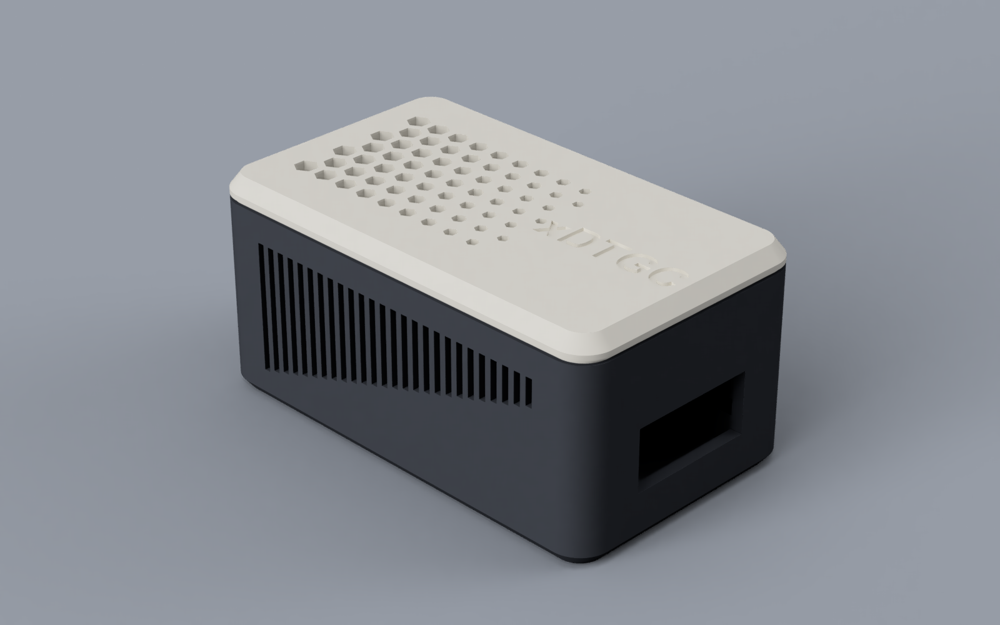
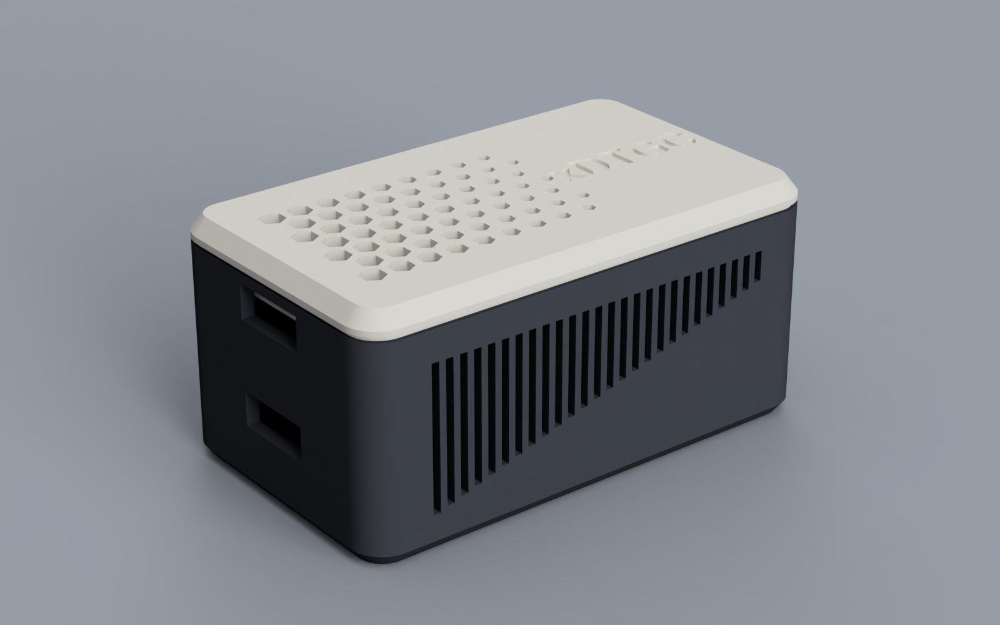
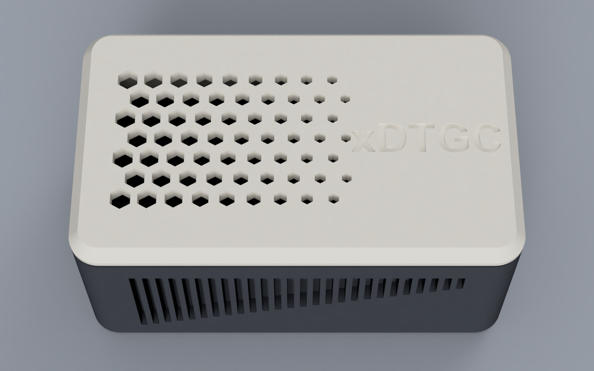
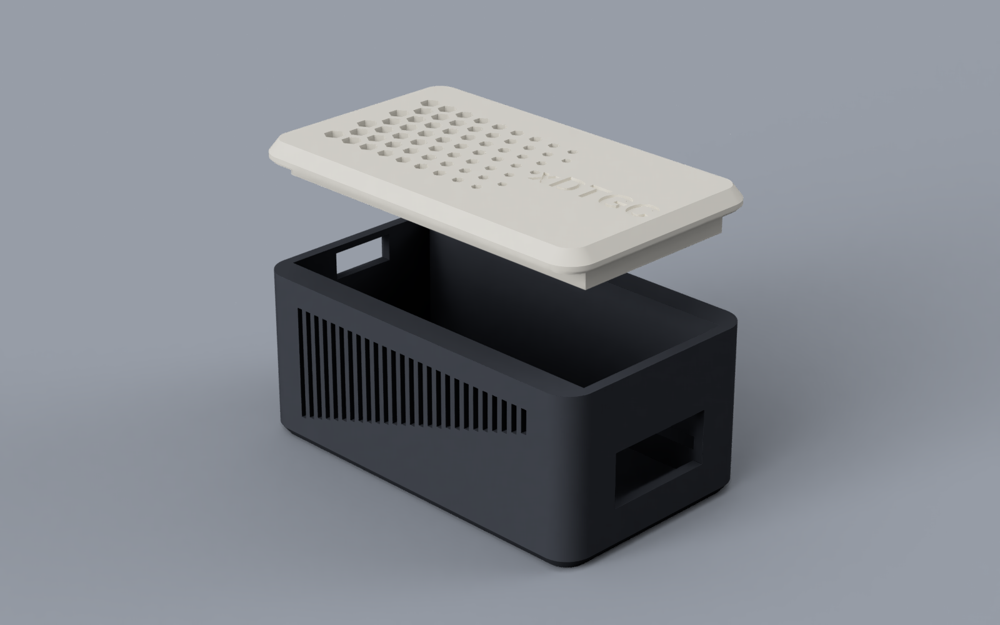
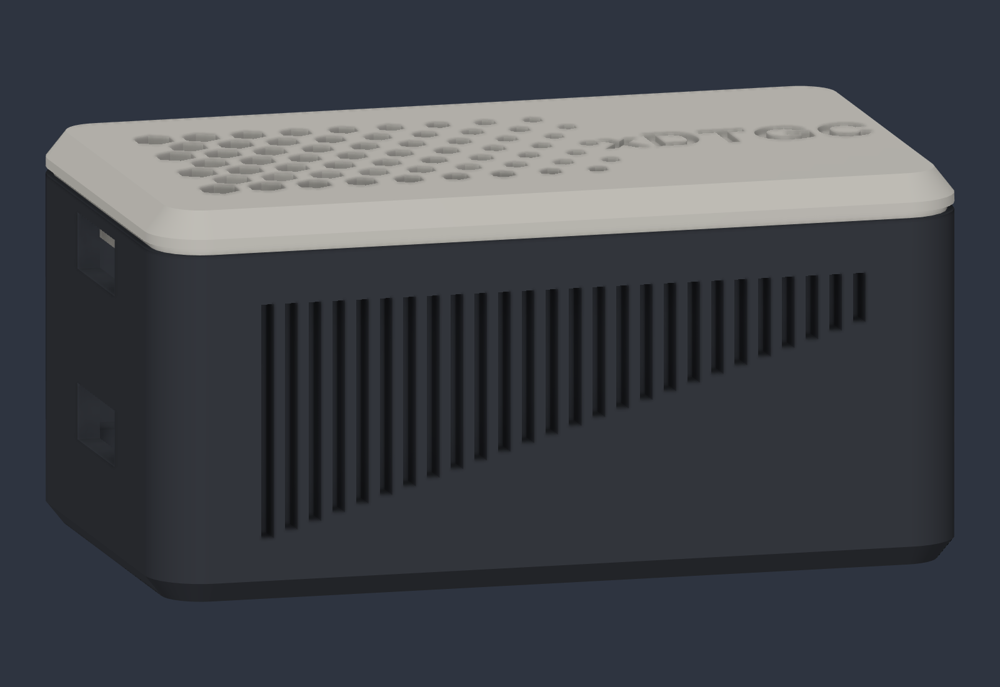

# xDTGC case (Milestone 13)

A two-part 3D-printed case: a tray that holds the Tang Nano 20K with the backpack on top, and a push-on lid. There are two versions with the same space inside and the same connector holes:

- **Plain** (`scripts/case_stl.py`): a simple box with vent slots, made without any CAD program.
- **Sculpted** (`scripts/case_fusion.py`, run inside Autodesk Fusion): the one in the picture, described below.

Every picture here is a computer render of the files, not a photo of a real print. Nothing has been test-fitted.

**Do not print it yet.** The drawing I have of the Tang gives only its outline (54.04 x 22.55 mm), not its connector positions or part heights. Those numbers are my placeholders, so a print made today would probably not fit.

## Sculpted case (third version, 2026-11-11)

| | |
|---|---|
|  |  |
|  |  |

Outside size with the lid on: 58.0 x 34.2 x 27.7 mm.

- **Two colours.** A dark tray and a pale lid. They are two separate prints, so this needs two filament colours but not a multi-colour printer. The colours in the pictures are only a suggestion.
- **Fins on both long sides.** 26 slots per side, 0.9 mm wide and 2.1 mm deep, leaving fins 0.8 mm thick (two passes of a 0.4 mm nozzle). The lower end of the slots climbs from one end of the case to the other. The fins are for looks: they do not go through the wall, and 2.1 mm of solid wall is left behind them.
- **Honeycomb vents in the lid.** 63 six-sided holes that go right through, 2.6 mm across at one end and shrinking to 1.2 mm toward the name. These are the real vents.
- **Flat lid top with a sloped edge**, so the lid prints upside down with its top on the bed and needs no supports. The name is sunk 0.4 mm into the top.
- **A shadow line** 0.5 mm high where the lid meets the tray. A small gap there looks deliberate, which hides small errors in the fit.
- **Round corners** of 4 mm radius. A larger radius would make the wall thinner than 1.6 mm at the corners.

Files: `pcb/case/xdtgc_case_sculpted_tray.stl`, `pcb/case/xdtgc_case_sculpted_lid.stl` and `pcb/case/xdtgc_case_sculpted.step` (for editing in a CAD program).
`python scripts/case_finish.py` turns the parts the right way up for printing and checks them: both are closed surfaces, which a slicer (the program that prepares a 3D print) needs, and neither reaches into the space kept for the boards.

To remake it after a size changes: run `python scripts/case_stl.py`, then run `scripts/case_fusion.py` and `scripts/case_render.py` inside Fusion (the first lines of each say how), then `python scripts/case_finish.py`.

## Plain case

Files: `pcb/case/xdtgc_case_tray.stl` and `pcb/case/xdtgc_case_lid.stl`. Both are closed surfaces. Print the lid with its flat top on the bed.

## Before printing

When both boards are here:

1. With calipers, measure each number marked VERIFY at the top of `scripts/case_stl.py`.
2. Tell me the numbers, or edit them in the script yourself.
3. Run `python scripts/case_stl.py` to remake the files, then the steps above for the sculpted case.

Holes:

| Hole | Wall | For |
|---|---|---|
| Upper | USB end | Backpack USB-C, the one normal use needs |
| Lower | USB end | The Tang's own USB port, for flashing |
| Large | Far end | HDMI. Which end the Tang's HDMI is really on is VERIFY |

The lid is held by friction only, using a 0.2 mm gap around its lip. That gap may need changing for your printer (`FIT` in the script).
